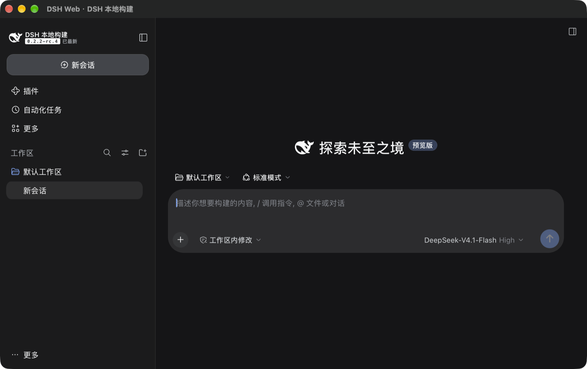

# DSH Web Launcher

把 [DSH](https://github.com/deepseek-ai/deepseek-harness) 的 Web 界面做成一个 macOS App：双击起 `dsh web`，关窗停 host。只做起进程、显示页面、关窗收尾三件事，用系统 WebKit 加一个子进程就够，不用 Electron——App 本体不到 1 MB，而 DSH Desktop 装完 2 GB 多。

> 非官方工具，和 DeepSeek / DSH 官方没有隶属关系。App 图标取自 DSH Web 的图标资源，仅用于标识本启动器，不在本仓库 MIT 许可范围内。



## 安装

要求：macOS 13+、Xcode Command Line Tools（`swiftc`）、Node.js，以及一份构建好的 DSH 源码检出（至少要有 `apps/cli/lib/bin.js`）。

```sh
git clone https://github.com/DSH43/dsh-web-launcher.git
cd dsh-web-launcher
./scripts/install.sh        # 编译并复制到 ~/Applications
```

装好后从 `~/Applications` 或访达双击 **DSH Web**，第一次启动会写出配置文件。`build.sh` 只组装到 `dist/`，`install.sh` 会先调它再复制；换图标跑 `make-icon.sh`，改完逻辑用 `scripts/smoke.sh` 做一次生命周期自检（起、取 URL、关、查进程）。

默认 ad-hoc 签名，每次重编后系统权限（屏幕录制、辅助功能）会失效。有 Developer ID 证书时用 `DSH_CODESIGN_IDENTITY="Developer ID Application: ..." ./scripts/install.sh` 签名，权限就能跨版本保留。

## 配置

`~/.dsh/web-launcher.json`，第一次启动自动生成，路径支持 `~`：

```json
{
  "node": "/opt/homebrew/bin/node",
  "cli": "~/Code/deepseek-harness/apps/cli/lib/bin.js",
  "cwd": "~/Documents/workspace-ds",
  "host": "127.0.0.1",
  "port": 3080,
  "extraArgs": [],
  "env": {}
}
```

- `node` / `cli` / `cwd` 留空时按默认路径探测；`cwd` 影响新建会话的默认工作区。
- `host` 默认只绑本机回环，`port` 默认 3080。
- `extraArgs` 追加给 `dsh web`，`env` 以键值对注入给 host。

测试时可用 `DSH_LAUNCHER_NODE`、`DSH_LAUNCHER_CLI`、`DSH_LAUNCHER_PORT` 覆盖。启动器会先取登录 shell 的 `PATH` 再传给 host，所以从 Finder 启动也能用 nvm、pyenv、Homebrew 里的路径。

## 行为

- 轻点（触控板 tap to click）和按压一样一下就响应：窗口开 `acceptsMouseMovedEvents` 让 WebKit 的 hit-test 位置保持新鲜，网页容器覆写 `acceptsFirstMouse` 让切回应用后的第一次点击直接落到控件上。不要在 `mouseDown` 里改第一响应者——轻点的按下和抬起同批到达，中间插一次焦点变更会让页面合成不出 `click`。
- 启动 `node <cli> web --no-open --host <host> --port <port>`，从它的 stdout 里取带一次性 token 的 URL，用 WKWebView 打开。60 秒没等到 URL 就判定失败，停掉 host 并显示错误页，附 stderr 和日志路径。
- 关窗、Cmd+Q、`kill -TERM` 走同一条退出路径：先 SIGTERM，7 秒不退再 SIGKILL，host 停掉后 App 才退出。
- 下载存到 `~/Downloads`，外部链接交给系统浏览器，页面的 alert/confirm/prompt 用原生弹窗。日志在 `~/Library/Logs/DSH Web Launcher.log`，菜单「显示 → 打开日志」直接打开。
- 启动前先看端口，被占用时弹原生提示：
  - 进程看起来是 dsh web（命令行含 `bin.js web` 或 `dsh web`）→ 可选「停止并启动」：SIGTERM，8 秒不退再 SIGKILL，端口空出来后起自己的 host。自动升级用 `nohup` 留下的、没有终端窗口的 host 也能这样停。
  - 看起来不是 dsh → 只列 PID 和命令行，不动它，也不会起第二个 host；选「取消」就停在错误页。
  - DSH 没有单实例锁，两个 host 会写同一份会话存储，所以这里不提供「同时开两个」。

## 在启动器里升级 DSH

启动器给 host 设置 `DSH_LAUNCHER=1`，`dsh-version-check` 0.3.1 起认这个变量：升级时照常停 host，但不再自己 `nohup ./start.sh`，也不开浏览器。

启动器看到 host 退出后检查 `$DSH_HOME/state/dsh-version-check/upgrade/building`：锁在就显示「DSH 正在升级」，每 2 秒轮询一次（最多等 30 分钟）；锁消失就重启子进程、重新取 token 加载页面。升级期间关掉窗口也没关系——构建进程是 detached 的，会跑完且不会再起 host，下次打开 App 就是新版本。插件低于 0.3.1 时升级完会自己起一个 host，启动器这边变成端口占用或服务退出，`关窗就停` 不成立，先把插件更新到 0.3.1 以上。

## 限制

- 内核是 WKWebView（Safari），不是 Chrome。DSH 的常规功能都正常，Chrome 扩展不可用，个别依赖 Chromium 行为的边缘功能可能有差异。
- 登录类 popup 交给系统浏览器打开，登录完成后不会回灌到这个 App 的会话。
- 拖拽文件上传在 WKWebView 下可能不灵，用附件的文件选择按钮。
- 关窗立刻停 host，正在跑的 agent 任务会中断——这是「关窗就停」的代价。
- 启动器被强制杀掉（活动监视器、`kill -9`）时来不及收尾，host 会成为孤儿进程。清理：`pkill -f "bin.js web --no-open --host"`。正常关窗和 Cmd+Q 不受影响。
- 依赖 DSH 源码检出的目录结构；全局 npm 安装的 DSH 要自己把 `cli` 指到对应入口。

## 卸载

```sh
rm -rf ~/Applications/DSH\ Web.app
rm -f ~/.dsh/web-launcher.json
```

## 许可

代码使用 MIT 许可，见 `LICENSE`。`assets/AppIcon.icns` 来自 DSH 的图标资源，版权归上游，仅作为本启动器的标识。
